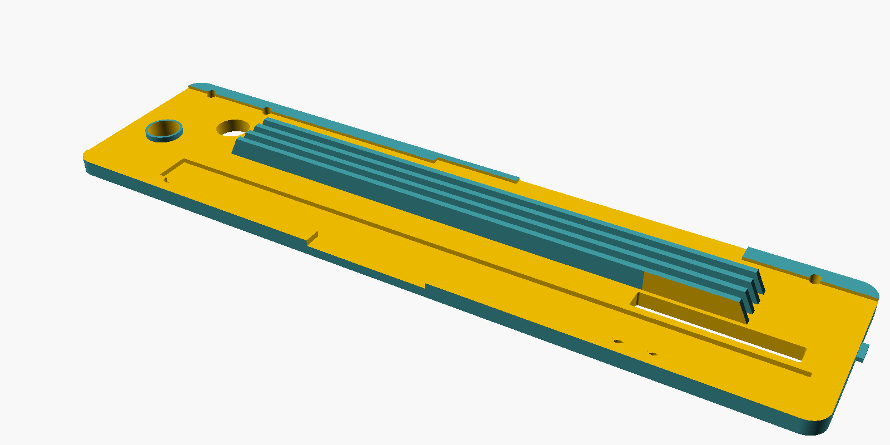
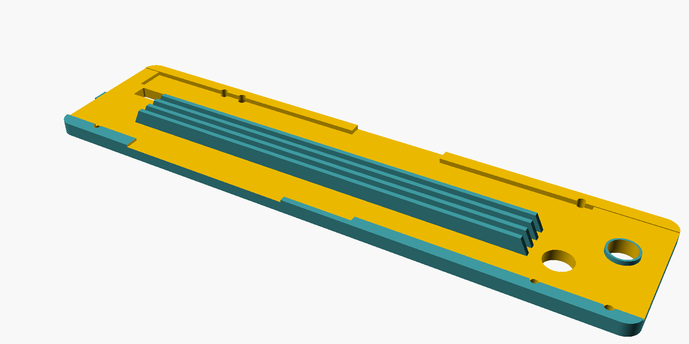

# Evolution R255 TBL Zero-Clearance Throat Plate

A parametric, 3D-printable zero-clearance throat plate for the **Evolution R255 TBL** table saw, modeled in OpenSCAD.

The plate has no pre-cut blade slot. You raise the spinning blade through it, so it cuts its own kerf and supports the workpiece right up to the blade. It fits with the riving knife installed and is meant for **90° cuts only**.

> **Status:** Not yet test-printed. Print the fit-test frame first (see [Printing](#printing)).



| Top (front of saw on the left) | Underside |
|---|---|
|  |  |



## Features

- **Pre-cut riving knife slot.** You don't have to extend the kerf into a knife slot on the saw.
- **Two counterbored hold-down screw holes**, in the same places as on the factory plate.
- **Full support.** Pads under the plate rest on the table's ledges and the aluminum rail, as well as the four leveling screws, so the plate doesn't flex.
- **No sideways play.** The thickness over the rail matches the rail's height, unlike earlier community designs.
- **Stiffening ribs** below the plate, kept clear of the blade, the riving knife and the lock.
- **Compatible lock.** It accepts the glued two-piece lock from the [reference model](#credits).
- **Prints on a 256 × 256 mm bed.** The plate is split into two halves joined by a glued dovetail.
- **Fully parametric.** Every measured dimension is a top-level variable in `throat_plate.scad`.

## Files

| File | Description |
|---|---|
| `throat_plate.scad` | The OpenSCAD model |
| `SPEC.md` | Full specification: measurements, design decisions and fitting procedure |
| `stl/` | Generated STLs (git-ignored; rebuild with the command below) |
| `preview/` | Rendered preview images |

### Model outputs

Choose the output with the `part` variable:

| `part` | Output |
|---|---|
| `assembled` | Whole plate in saw coordinates, for reference only (too long to print in one piece) |
| `front`, `back` | The two printable halves, oriented top-face-down |
| `modifier_front`, `modifier_back` | Blade-strip volumes for a 100 % infill modifier in the slicer |
| `fit_front`, `fit_back` | A 2 mm fit-test frame with every hole, the back tab and the dovetail joint |

## Building

Requires [OpenSCAD](https://openscad.org/) (a nightly build, for the Manifold backend).

```sh
mkdir -p stl
for p in assembled front back modifier_front modifier_back fit_front fit_back; do
  openscad-nightly --backend=manifold --export-format binstl \
    -D "part=\"$p\"" -o stl/$p.stl throat_plate.scad
done
```

Regenerate the preview images with:

```sh
render() {
  openscad-nightly --backend=manifold --render -D 'part="assembled"' \
    --camera="$2" --projection="$3" --imgsize="$4" --colorscheme=Tomorrow \
    -o "preview/$1.png" throat_plate.scad
}
render top                47,188,0,0,0,90,420    o 1600,440
render underside          47,188,0,180,0,90,420  o 1600,440
render underside_iso      47,188,-5,235,0,60,520 p 1600,800
render underside_iso_back 47,188,-5,235,0,240,520 p 1600,800
```

### Coordinates

The model uses a right-handed coordinate system, viewed from the operator's position:

- **X**: distance from the left wall of the table opening
- **Y**: distance from the front wall (the operator end) toward the back (the riving knife end)
- **Z**: 0 at the table surface, negative downward

`SPEC.md` gives many positions measured "from back". In the model these appear as `opening_len - d`.

## Printing

Developed for a Bambu Lab P1S. Any printer with a 256 × 256 mm bed works.

| Setting | Value |
|---|---|
| Material | PETG (PLA also works) |
| Orientation | Top surface face-down on the build plate (the STLs are already oriented this way) |
| Layer height | 0.2 mm |
| Walls | 6 |
| Infill | ≥ 25 %, plus a 100 % infill modifier on the blade strip so the kerf cuts through solid plastic |

To apply the modifier, load `modifier_front.stl` or `modifier_back.stl` as a modifier on the matching half. If it doesn't line up, add a box modifier instead: 15 mm wide, centered 36.5 mm from the left edge, full length, 7.1 mm deep.

1. **Test the fit.** Print `fit_front` and `fit_back`, join them, and drop the frame into the saw. Check the outline, every hole position, the back tab and the joint clearance. Adjust `fit_clearance` or any hole position if needed.
2. **Print the halves.** Print `front` and `back`.
3. **Glue them.** Glue the dovetail joint, clamping the halves face-down on a flat surface so the top stays flat.

## Installation

1. Set the blade **fully lowered and at 90°**.
2. Drop the plate in, back tab first under the table's back lip, with the riving knife through its slot.
3. Adjust the four leveling screws through the access holes (3 mm hex key) until the plate is flush with the table.
4. Install the two hold-down screws.
5. With the plate **screwed down** (not held by hand), switch on and slowly raise the blade through the plate to cut the zero-clearance kerf.

## ⚠️ Safety

- **Never tilt the blade with this plate installed.** The aluminum rail that supports the plate moves when the blade tilts.
- Always cut the kerf with the plate screwed down, never held by hand.
- This is a homemade accessory. Check the fit and flatness carefully before use, and use it at your own risk.

## Customizing

All dimensions are top-level variables in `throat_plate.scad`, grouped for the OpenSCAD Customizer. Common ones:

| Variable | Default | Purpose |
|---|---|---|
| `fit_clearance` | 0.25 | Gap per side between the plate and the opening wall |
| `ledge_gap`, `rail_gap` | 0.3 | Gap between the support pads and the ledges or rail. Set to 0 to rest the plate directly on them |
| `seam_y` | 188.5 | Position of the split seam, measured from the front |
| `joint_clearance` | 0.15 | Total gap in the dovetail joint |
| `rib_depth` | 17 | How far the ribs reach below the table surface (the blade top sits at 20 mm when fully lowered) |

See `SPEC.md` §9 for the full parameter list and the source of each measurement.

## Credits

The lock interface and the finger-lift hole position follow [*Evolution R255 TBL Throat Plate* by Woodwork Journey](https://makerworld.com/en/models/1796905) on MakerWorld. The rest of the plate is designed from scratch from measurements of the saw.

## License

The reference model is licensed [CC BY-NC-SA 4.0](https://creativecommons.org/licenses/by-nc-sa/4.0/), and this design adapts parts of it. Any shared version of this project is therefore distributed under **CC BY-NC-SA 4.0**: credit is required, commercial use is not allowed, and derivatives must use the same license. See [LICENSE](LICENSE) for the full text.
